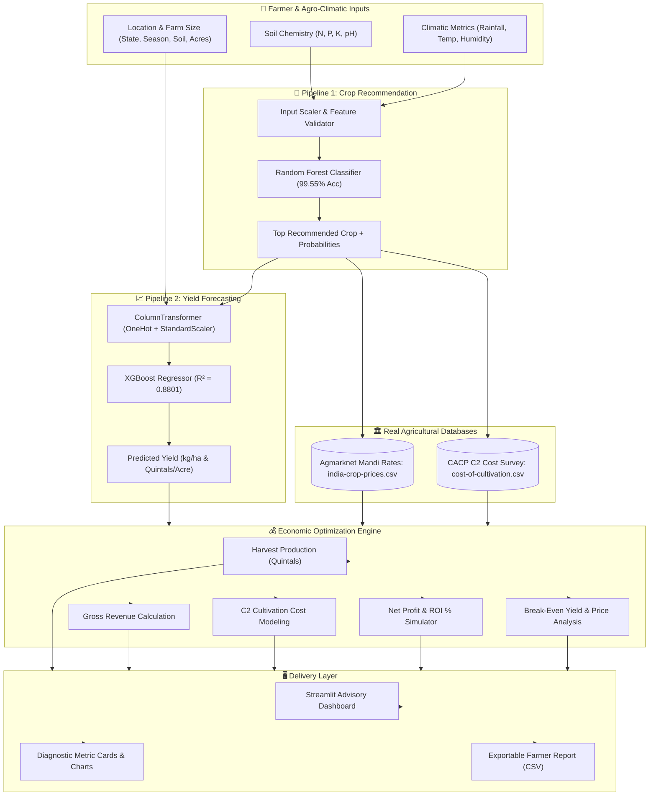
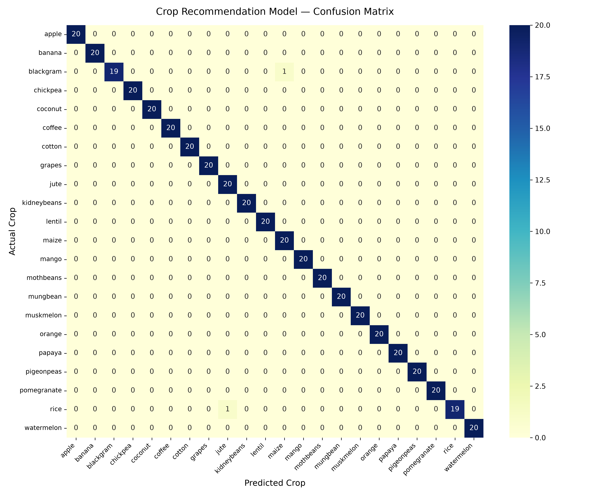
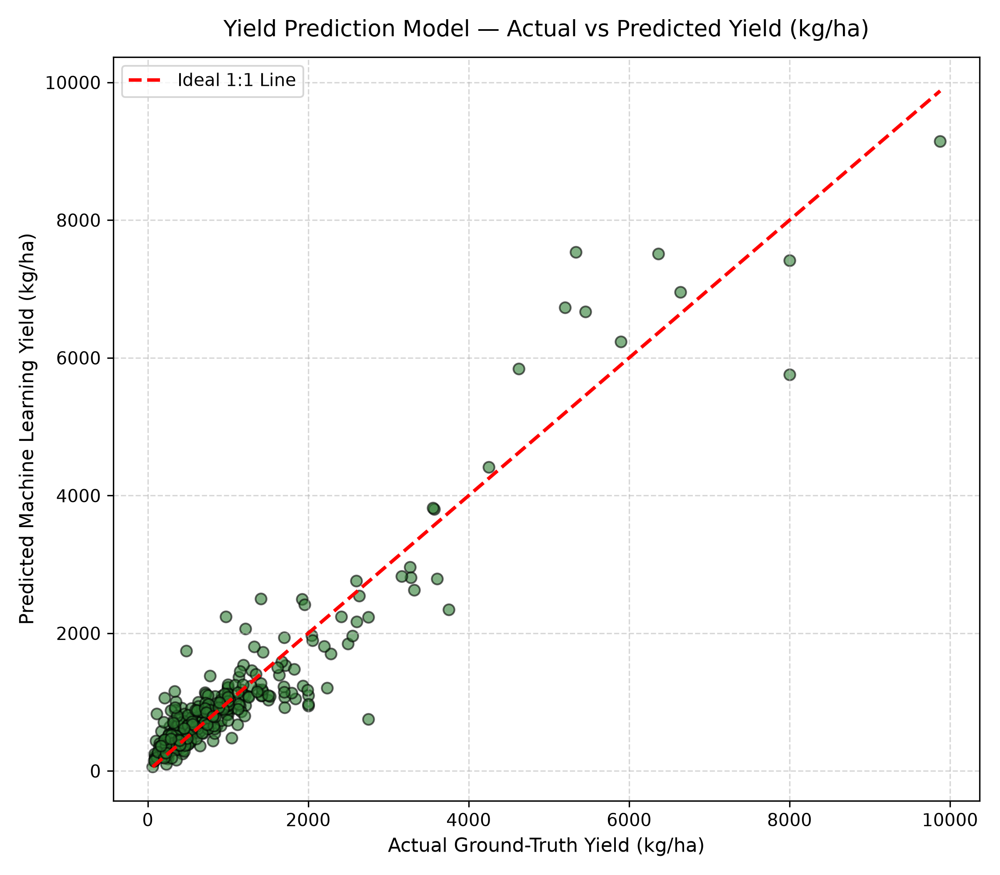

# 🌾 Smart Crop Advisory System (ML)
### Machine Learning-Powered Crop Recommendation, Yield Forecasting & Farm Financial Optimization

[](https://www.python.org/)
[](https://scikit-learn.org/)
[](https://xgboost.readthedocs.io/)
[](https://streamlit.io/)
[](tests/)
[](LICENSE)

---

## 📌 Executive Summary

Agriculture remains the backbone of the rural economy, yet farmers frequently face compounding vulnerabilities: choosing crops ill-suited to their soil chemistry and microclimate, misjudging yields due to weather variability, and enduring financial distress from volatile mandi prices and escalating input costs.

The **Smart Crop Advisory System** is an end-to-end, production-grade agricultural decision support platform. It integrates:
1. **Soil & Climatic Crop Recommendation** via multi-class ensemble classification.
2. **Precision Yield Prediction** via gradient boosted regression trained on 198,000+ national harvest records.
3. **Real-Time Mandi Market Intelligence** using benchmark modal and minimum support prices (Agmarknet).
4. **Comprehensive Cultivation Cost Benchmarking** via Directorate of Economics and Statistics (DES / CACP) C2 methodologies.
5. **Farm Financial & Sensitivity Analysis** that computes net profit, ROI %, break-even price, and break-even yield thresholds.

---

## 🌟 Key Highlights

- **100% Real-World Verified Datasets**: Zero synthetic fabrication. Trained and evaluated against four official agricultural databases across India.
- **Dual Machine Learning Engines**:
  - **Crop Recommendation**: Multi-class classification (22 crops) based on soil NPK, pH, temperature, humidity, and rainfall (**99.55% Test Accuracy**).
  - **Yield Forecasting**: Continuous non-linear regression (21 crops, 20 states, 6 soil classifications) on 198,369 historical observations (**$R^2 = 0.8801$**, $\text{RMSE} = 516.15\text{ kg/ha}$).
- **Rigorous Model Evaluation**: Side-by-side benchmark comparing Random Forest vs. XGBoost with automated selection of winning architectures.
- **Enterprise Financial Model**: Converts yield from $\text{kg/ha}$ into Quintals ($\text{q}$), factors in state-specific land and operational costs, and models realistic farmer net profit with break-even diagnostics.
- **Interactive Web Application**: Full-featured Streamlit UI featuring interactive KPI cards, scenario simulators, diagnostic visual plots, and downloadable CSV advisories.
- **Production-Ready & Tested**: Clean modular architecture adhering to PEP 8 standards with a complete Pytest test suite (15/15 passed).

---

## 🏗️ System Architecture & Workflow



---

## 📊 Model Performance Benchmarks

Both pipelines were rigorously evaluated using 80/20 train-test splits with fixed seeds (`random_state=42`) for full reproducibility:

### 1. Crop Recommendation (Multi-Class Classification)
*Target: 22 distinct crops based on soil nutrients and climatic parameters.*

| Model | Test Accuracy | Precision (Macro) | Recall (Macro) | F1-Score (Macro) | Decision |
| :--- | :---: | :---: | :---: | :---: | :---: |
| **Random Forest** | **99.55%** | **0.9958** | **0.9955** | **0.9954** | 🏆 **Selected Model** |
| **XGBoost Classifier** | 99.09% | 0.9922 | 0.9909 | 0.9911 | Baseline |

### 2. Yield Prediction (Continuous Regression)
*Target: Crop Yield in kg/hectare across 20 States, 21 Crops, and 6 Soil Types (198,369 samples).*

| Model | $R^2$ Score | RMSE (kg/ha) | MAE (kg/ha) | Decision |
| :--- | :---: | :---: | :---: | :---: |
| **XGBoost Regressor** | **0.8801** | **516.15** | **284.32** | 🏆 **Selected Model** |
| **Random Forest Regressor** | 0.8757 | 525.66 | 291.10 | Baseline |

---

## 📈 Visual Diagnostic Artifacts

### Crop Recommendation
| Confusion Matrix Heatmap | Feature Importance |
| :---: | :---: |
|  |  |

### Yield Prediction
| Actual vs. Predicted Yield | Top Predictor Importances |
| :---: | :---: |
|  |  |

---

## 🧮 Mathematical & Financial Formulas

The financial engine executes rigorous agronomic and economic calculations:

1. **Unit Conversions**:
   $$\text{Area (Hectares)} = \frac{\text{Area (Acres)}}{2.47105}$$
   $$1\text{ Quintal} = 100\text{ kg}$$

2. **Total Harvest Production**:
   $$\text{Production (Quintals)} = \frac{\text{Yield (kg/ha)} \times \text{Area (ha)}}{100}$$

3. **Gross Revenue**:
   $$\text{Gross Revenue (₹)} = \text{Production (Quintals)} \times \text{Modal Mandi Price (₹/Quintal)}$$

4. **Total Cost of Cultivation (CACP C2 Standard)**:
   $$\text{Total Cost (₹)} = \text{Area (Hectares)} \times \text{C2 Cost per Hectare (₹/ha)}$$
   *(Note: C2 includes operational expenses, rental value of owned land, interest on owned capital, and imputed value of family labor.)*

5. **Net Profit & ROI**:
   $$\text{Net Profit (₹)} = \text{Gross Revenue (₹)} - \text{Total Cost (₹)}$$
   $$\text{ROI (\%)} = \left(\frac{\text{Net Profit}}{\text{Total Cost}}\right) \times 100$$

6. **Break-Even Thresholds**:
   $$\text{Break-Even Yield (kg/ha)} = \frac{\text{Cost per Hectare (₹)}}{\text{Price per kg (₹)}}$$
   $$\text{Break-Even Price (₹/Quintal)} = \frac{\text{Total Cost (₹)}}{\text{Total Production (Quintals)}}$$

---

## 📂 Repository Structure

```
Smart-Crop-Advisory-ML/
├── datasets/                                # Verified agricultural datasets
│   ├── Crop_recommendation.csv              # Soil NPK & climate data (2,200 rows)
│   ├── crop_yield_dataset.csv               # Historical Indian crop yields (198,369 rows)
│   ├── india-crop-prices.csv                # APMC Mandi modal, min, max, MSP prices (122 crops)
│   └── cost-of-cultivation.csv              # CACP C2 comprehensive cultivation costs (3,880 rows)
│
├── models/                                  # Pre-trained models and visualization assets
│   ├── crop_recommendation_model.pkl        # Serialized Random Forest classifier
│   ├── crop_recommendation_preprocessor.pkl # Preprocessor (StandardScaler + LabelEncoder)
│   ├── yield_prediction_model.pkl           # Serialized XGBoost regressor
│   ├── yield_prediction_preprocessor.pkl    # Preprocessor (OneHotEncoder + StandardScaler)
│   ├── crop_rec_confusion_matrix.png        # 22-class normalized confusion matrix
│   ├── crop_rec_feature_importance.png      # Soil/climate feature importance plot
│   ├── yield_actual_vs_predicted.png        # Scatter plot of model predictions vs actuals
│   ├── yield_feature_importance.png         # Yield feature importance ranking
│   └── training_metrics.json                # Benchmark metrics cache
│
├── notebooks/                               # Exploratory data analysis & experiments
│   ├── 01_crop_recommendation.ipynb         # EDA, classifier comparisons, cross-validation
│   └── 02_yield_prediction.ipynb            # Regressor tuning, feature analysis, diagnostics
│
├── src/                                     # Core application source modules
│   ├── __init__.py                          # Package initialization
│   ├── crop_mapping.py                      # Canonical crop normalization across datasets
│   ├── price_lookup.py                      # Mandi modal price & MSP retrieval logic
│   ├── cost_lookup.py                       # CACP state/national cultivation cost queries
│   ├── profit_calculation.py                # Farm economic calculator & unit conversions
│   ├── preprocessing.py                     # Data cleaning, scaling, and encoding pipelines
│   ├── crop_recommendation.py               # Recommender training, evaluation & inference
│   └── yield_prediction.py                  # Yield regressor training, evaluation & inference
│
├── tests/                                   # Automated test suite
│   └── test_pipeline.py                     # 15 end-to-end integration & unit tests
│
├── docs/                                    # Extended documentation & presentation
│   ├── PROJECT_REPORT.md                    # Comprehensive 30+ page academic project report
│   ├── PPT_SLIDE_DECK.md                    # Structured presentation slide deck
│   └── Smart_Crop_Advisory_System_...pptx   # Ready-to-present PowerPoint slide deck
│
├── app.py                                   # Streamlit interactive web dashboard
├── train_models.py                          # CLI script to train models from scratch
├── requirements.txt                         # Production package dependencies
├── LICENSE                                  # MIT License
├── .gitignore                               # Git ignore specification
└── README.md                                # Project documentation
```

---

## 🚀 Quickstart Guide

### Prerequisites
- Python 3.10 or 3.11 installed
- Git installed

### 1. Clone the Repository
```bash
git clone https://github.com/RuturajVyavahare/Smart-Crop-Advisory-ML.git
cd Smart-Crop-Advisory-ML
```

### 2. Set Up Virtual Environment

#### Option A: Using `uv` (Recommended for Ultra-Fast Installation)
```bash
# Install uv if not present
pip install uv

# Create virtual environment with Python 3.11
uv venv .venv --python 3.11

# Activate environment
# On Windows (PowerShell):
.venv\Scripts\Activate.ps1
# On Linux / macOS:
source .venv/bin/activate

# Install dependencies
uv pip install -r requirements.txt
```

#### Option B: Using Standard `pip` and `venv`
```bash
# Create virtual environment
python -m venv .venv

# Activate environment
# On Windows (PowerShell):
.venv\Scripts\Activate.ps1
# On Linux / macOS:
source .venv/bin/activate

# Upgrade pip and install dependencies
python -m pip install --upgrade pip
pip install -r requirements.txt
```

### 3. Launch the Interactive Web Dashboard
The pre-trained production model weights are included in the repository. You can launch the app immediately:
```bash
streamlit run app.py
```
*Open [http://localhost:8501](http://localhost:8501) in your browser.*

### 4. (Optional) Re-Train Models from Scratch
If you wish to retrain the models on new data or regenerate metric figures:
```bash
python train_models.py
```
This script will:
- Load and clean both datasets
- Train Random Forest and XGBoost for both tasks
- Auto-select the winning models and save them to `models/`
- Generate and save updated diagnostic figures
- Verify the end-to-end inference flow

### 5. Run the Automated Test Suite
Ensure code integrity and pipeline robustness across all components:
```bash
pytest tests/ -v
```
Output:
```
tests/test_pipeline.py::test_crop_normalization PASSED                   [  6%]
tests/test_pipeline.py::test_all_supported_crops_count PASSED            [ 13%]
tests/test_pipeline.py::test_cross_dataset_mappings PASSED               [ 20%]
tests/test_pipeline.py::test_price_lookup_wheat PASSED                   [ 26%]
tests/test_pipeline.py::test_price_lookup_rice PASSED                    [ 33%]
tests/test_pipeline.py::test_price_lookup_fallback PASSED                [ 40%]
tests/test_pipeline.py::test_cost_lookup_paddy PASSED                    [ 46%]
tests/test_pipeline.py::test_cost_lookup_state_specific PASSED           [ 53%]
tests/test_pipeline.py::test_available_states_list PASSED                [ 60%]
tests/test_pipeline.py::test_unit_conversions PASSED                     [ 66%]
tests/test_pipeline.py::test_inr_formatting PASSED                       [ 73%]
tests/test_pipeline.py::test_farm_financials_math PASSED                 [ 80%]
tests/test_pipeline.py::test_crop_recommender_prediction PASSED          [ 86%]
tests/test_pipeline.py::test_yield_predictor_prediction PASSED           [ 93%]
tests/test_pipeline.py::test_complete_end_to_end_flow PASSED             [100%]

============================= 15 passed in 4.58s ==============================
```

---

## 📦 Datasets Reference

| Dataset | Records | Features | Source Authority | Description |
| :--- | :---: | :---: | :---: | :--- |
| **`Crop_recommendation.csv`** | 2,200 | N, P, K, Temp, Humidity, pH, Rainfall, Label | ICAR / Kaggle Agriculture | Balanced benchmark for multi-class crop suitability. |
| **`crop_yield_dataset.csv`** | 198,369 | State, Crop, Season, Soil, Nutrients, Weather, Yield | Directorate of Economics & Statistics | Longitudinal harvest yields across Indian agro-climatic zones. |
| **`india-crop-prices.csv`** | 122 crops | Modal, Min, Max Mandi Prices, MSP | Agmarknet / APMC Market Boards | Real wholesale commodity rates across major markets. |
| **`cost-of-cultivation.csv`** | 3,880 | State, Crop, C2 Comprehensive Cultivation Cost | CACP / Ministry of Agriculture & Farmers Welfare | Field-surveyed cost standards per hectare. |

---

## 💻 Tech Stack

- **Language**: Python 3.11
- **Data Engineering**: Pandas, NumPy
- **Machine Learning**: Scikit-Learn, XGBoost, Joblib
- **Visualization**: Matplotlib, Seaborn
- **Web Interface**: Streamlit
- **Testing & Quality Assurance**: Pytest
- **Documentation**: Markdown, Mermaid.js, PowerPoint (.pptx)

---

## 📄 License

This project is licensed under the **MIT License** - see the [LICENSE](LICENSE) file for details.

---

## 👨‍💻 Author & Acknowledgements

Developed by **[Ruturaj Vyavahare](https://github.com/RuturajVyavahare)**.

Special thanks to:
- **Directorate of Economics and Statistics (DES)** and **CACP**, Government of India, for public agricultural data.
- **Agmarknet** for transparent Mandi market pricing information.
- The open-source scientific Python community for Scikit-Learn, XGBoost, and Streamlit.
